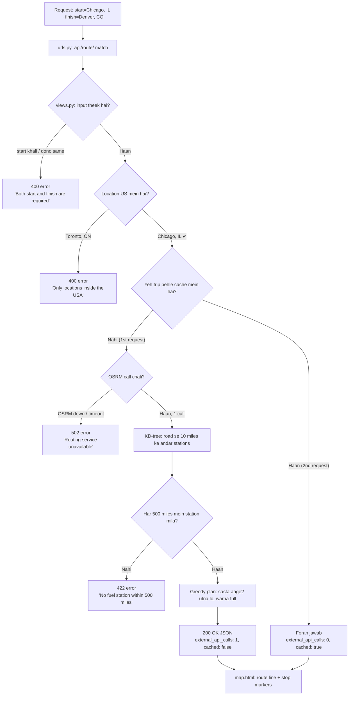

Yeh wahi flow hai, lekin har scenario ek example ke saath:

Is graph ko Loom mein aise bol sakte hain:

- Normal case mein Chicago se Denver ki pehli request par sirf 1 OSRM call hoti hai.
- Wahi trip doosri dafa bhejein to answer cache se aata hai aur API calls 0 hoti hain.
- Galat input ya Canada ka shehar ho to 400 aata hai, OSRM band ho to 502, aur 500 miles mein koi station na mile to 422.
